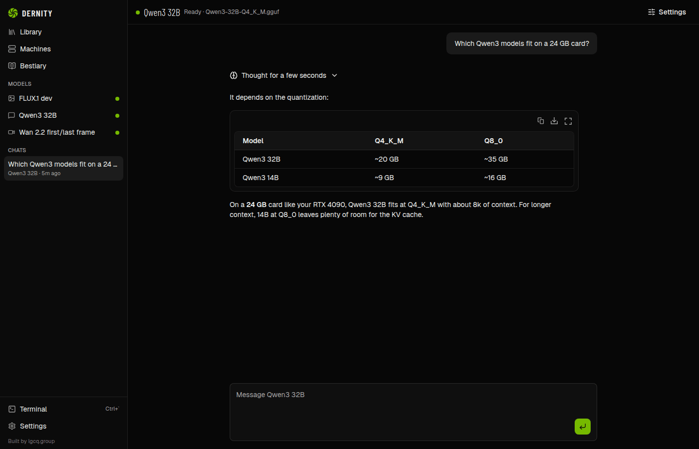
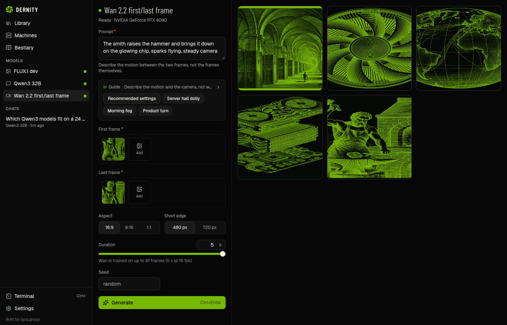
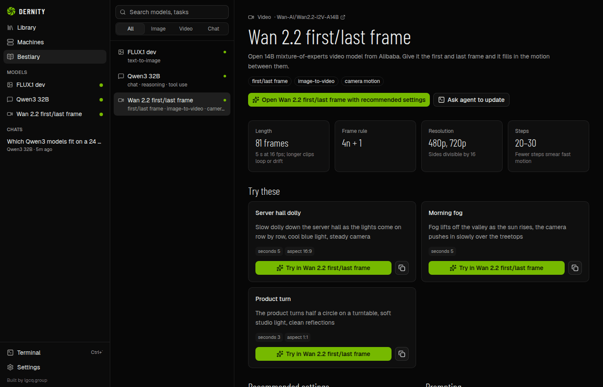

<p align="center">
  
</p>

<h1 align="center">Dernity</h1>

<p align="center">
  Your own AI lab on rented GPUs.<br>
  Deploy open models on Vast.ai or RunPod by asking your coding agent, then use them from one desktop window.
</p>

<p align="center">
  <a href="https://dernity.org"><b>Website</b></a> ·
  <a href="https://github.com/lgcq-group-org/dernity/releases/latest"><b>Download</b></a> ·
  <a href="#getting-started">Getting started</a> ·
  <a href="#how-it-works">How it works</a> ·
  <a href="#your-data">Your data</a>
</p>

<p align="center">
  
</p>

## Why

Running your own models on rented GPUs is cheap, but the workflow around it is messy: picking a machine on
one site, starting a server over SSH, copying URLs into some chat UI, a separate tool for images, and
remembering to stop the machine afterwards.

Dernity puts that in one place:

- **Deploy by asking.** Open the built-in terminal, start Claude Code, Codex or any agent CLI you already use,
  and say "deploy Qwen3 32B". It looks the model up, compares GPU offers on Vast.ai and RunPod, waits for you
  to pick one, starts the server and connects it to the app.
- **One window for every model.** Text models get a chat. Image and video models get a generation studio.
- **The UI fits the model.** If a video model takes a first and last frame, you get two frame slots. If an
  image model takes references, you can attach them. If it doesn't, the field isn't there.
- **A guide to every model.** After a deploy the agent writes down what the model can do, its limits,
  prompts that work and which GPUs it fit on. The Bestiary shows it as cards, and one click fills the
  studio with an example or the recommended settings. The agent reads it again before the next deploy.
- **Know what you're paying for.** Balances, running and stopped machines, $/h, and a history of what ran
  where, with a button to bring it back.

<p align="center">
  
</p>

<p align="center">
  
</p>

## Getting started

### 1. Install

Grab the file for your system from the [latest release](https://github.com/lgcq-group-org/dernity/releases/latest):

| System | File |
| --- | --- |
| Linux | `.AppImage` (any distro) or `.deb` (Debian, Ubuntu) |
| macOS | `-mac-arm64.dmg` for Apple Silicon, `-mac-x64.dmg` for Intel |
| Windows | `.exe` installer |

The builds aren't signed yet, so the first launch needs one extra click:

- **macOS:** right-click Dernity in Applications and choose **Open**.
- **Windows:** on the SmartScreen warning, click **More info**, then **Run anyway**.
- **Linux AppImage:** make it executable first: `chmod +x Dernity-*.AppImage`.

### 2. Have an agent ready

Dernity doesn't ship its own AI. It runs the agent CLIs you already have, logged in as you, so there are no
extra API keys to set up. Any of these works and is detected automatically:

Claude Code · Codex · Gemini CLI · OpenCode · Cursor Agent · Qwen Code · Aider · Goose · Amp · Crush

### 3. Connect a GPU provider

You need an account with money on it at [Vast.ai](https://vast.ai) or [RunPod](https://runpod.io).

- **API key.** If you use the `vastai` or `runpodctl` CLI, Dernity reads the key from their config.
  Otherwise paste it in **Settings**; it's stored encrypted with your system keychain.
- **Hugging Face token** (optional). Gated models need one. Paste it in **Settings** and agent terminals
  get it as `HF_TOKEN`.
- **SSH key.** Add your public SSH key to your Vast.ai or RunPod account. The agent sets model servers up
  behind an SSH tunnel or a token, so nobody else can use them.

### 4. Deploy your first model

Open the terminal (<kbd>Ctrl</kbd>+<kbd>`</kbd>), start your agent and ask for what you want:

> Deploy Qwen3 8B for chat on something cheap

The agent shows you a few machines with prices and waits for your choice. When the server is up, the model
appears in the sidebar with a green dot. Click it and start chatting.

More things to try:

> Deploy Wan 2.2 image-to-video with first and last frame
>
> Connect my running Vast instance flux-dev, ComfyUI is on port 8188
>
> Run again the Qwen I had yesterday

When you're done, ask the agent to stop or delete the machine, or do it from your provider's dashboard.
Stopped machines on Vast.ai still cost a little for their disk.

## How it works

```
 you ──▶ agent in the built-in terminal ──▶ rents a GPU, starts the model server
                     │
                     ▼
        ~/Dernity/workspace/models/qwen3-8b.json   ◀── the agent writes a config
                     │
                     ▼
 Dernity reads it ──▶ sidebar entry, chat or studio form, health checks ──▶ SSH tunnel ──▶ GPU
```

Each model is a small JSON file: where it runs, which API it speaks, and what it accepts. The app watches
the folder and updates as soon as a file changes. You can edit these files by hand too.

```json
{
  "id": "wan22-flf2v",
  "name": "Wan 2.2 first/last frame",
  "kind": "video",
  "protocol": "comfyui",
  "host": { "type": "runpod", "podName": "wan22", "port": 8188, "tunnel": true },
  "inputs": [
    { "key": "first_frame", "label": "First frame", "accept": "image", "required": true },
    { "key": "last_frame", "label": "Last frame", "accept": "image", "required": true }
  ],
  "params": [{ "key": "seconds", "label": "Duration", "type": "number", "min": 1, "max": 5, "default": 5 }],
  "options": { "workflow": "wan22-flf2v.json" }
}
```

What it can talk to:

| | Supported |
| --- | --- |
| Model servers | Anything OpenAI-compatible (llama.cpp, vLLM, SGLang, Ollama, TGI, LM Studio) and ComfyUI |
| Where they run | Vast.ai, RunPod, any machine you can SSH into, or a plain URL |

The agent's instructions and skills live in [`workspace/`](workspace) and are copied into
`~/Dernity/workspace` on every start. They cover deploying, connecting, describing a model's capabilities,
and redeploying from history, plus the rules agents must follow (ask before spending money, never expose a
server without authentication, never print secrets).

## Your data

Everything stays on your computer, in plain files you can open, back up or delete:

```
~/Dernity/
  workspace/   where your agent works: instructions, skills, model configs, ComfyUI workflows
  library/     every generation in its own folder: prompt, parameters, references and outputs
  chats/       chat history
```

There's no account, no cloud and no telemetry. Your library and chats are kept away from the agent: they live
outside its workspace, agents are told never to touch them, and Claude Code is configured to deny reading them.

Set `DERNITY_HOME` to keep this folder somewhere else.

> [!NOTE]
> Whoever owns a rented GPU can, in principle, see what runs on it, including prompts and outputs.
> No app can change that. For anything sensitive, use datacenter hosts (RunPod Secure Cloud, verified
> datacenters on Vast.ai) and delete machines when you're done.

## Build from source

You need Node.js 22 or newer.

```bash
git clone https://github.com/lgcq-group-org/dernity.git
cd dernity
npm install
npm run dev     # start the app with hot reload
npm run dist    # build an installer for your system into dist/
```

Architecture, code style and the security rules for contributors are in [AGENTS.md](AGENTS.md).

## License

[MIT](LICENSE)

---

<p align="center"><a href="https://dernity.org">dernity.org</a> · Built by <a href="https://lgcq.group">lgcq.group</a></p>
